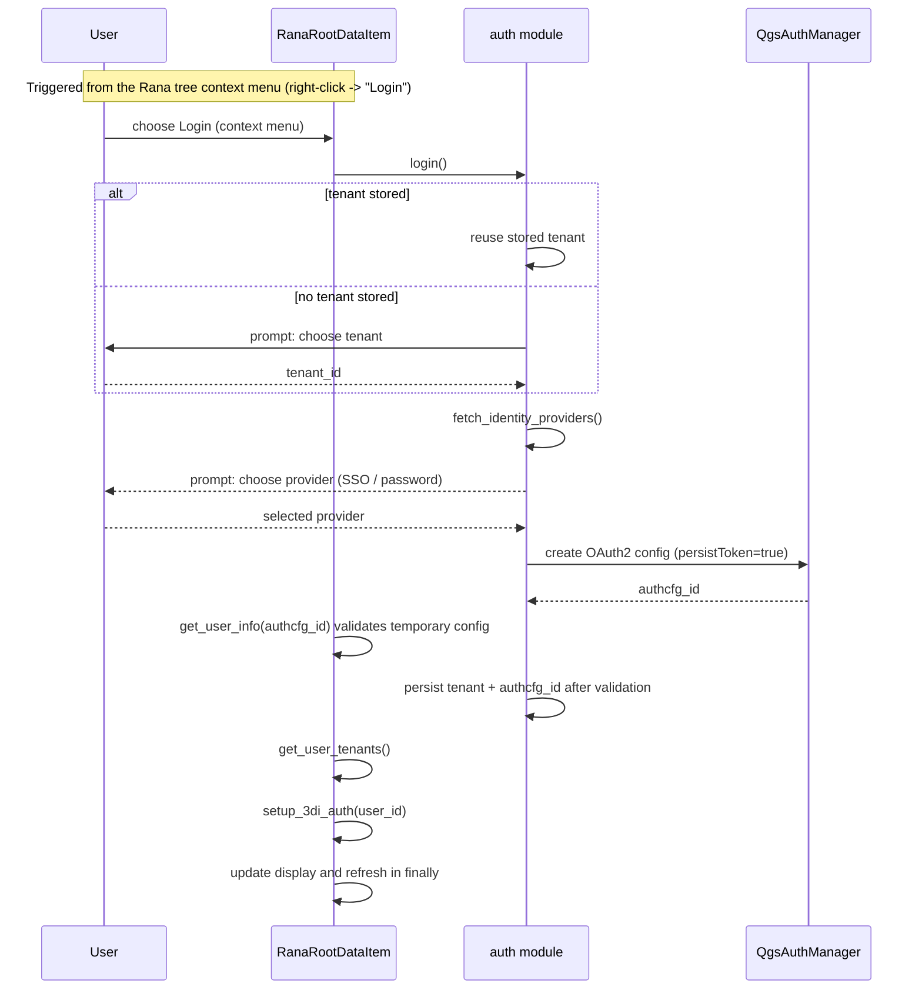
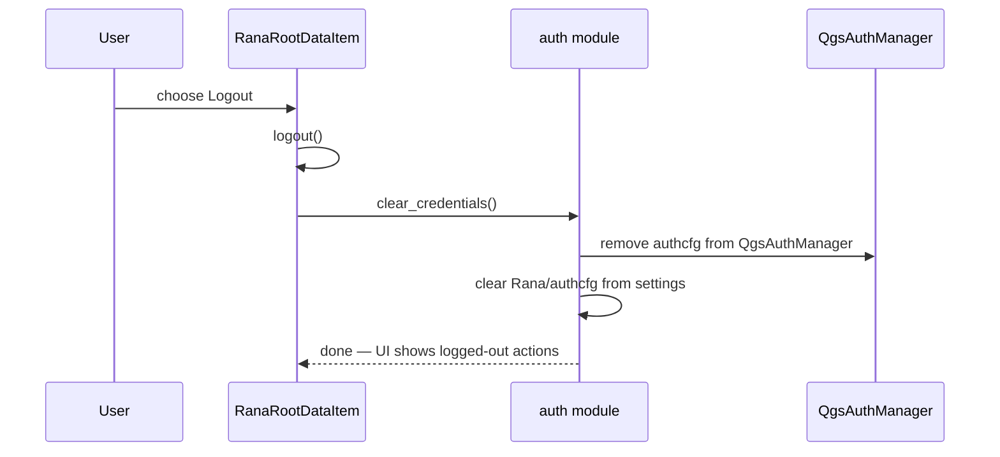
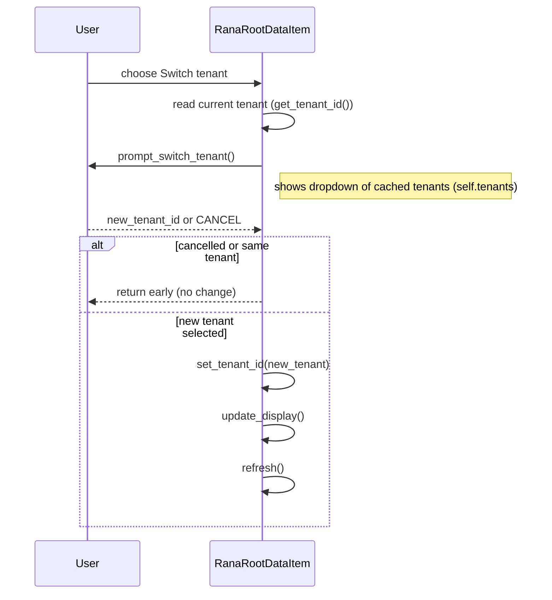

# Rana authentication — developer flow

This living document describes the auth lifecycle for the Rana Browser entrypoint. Update this file whenever auth behaviour changes.

## Architecture note

Auth primitives live in `rana_qgis_plugin/auth.py` as a module of plain functions. The `RanaRootDataItem` owns prompts, UI messages, and orchestration. All persistent state is stored in `QgsSettings` and `QgsAuthManager` — there is no in-memory auth state object.

## Login

Login is always initiated by the user from the Rana Browser context menu. If a
tenant is already stored (for example, from a previous session), it is reused;
otherwise the user is prompted for an organisation. The user then chooses an
authentication method.

## Startup after restart

Startup preserves an existing session. The user stays logged in across QGIS
restarts and plugin reloads until an explicit logout (or a backend URL change,
see below).

`RanaQgisPlugin.initGui()` does not touch the stored auth config and performs no
network request. `RanaRootDataItem.__init__()` does not call `restore_session()`,
so startup never initiates authentication or launches a browser. An interrupted
login is never resumed automatically: login persists the authcfg reference only
after `get_user_info()` validated it, so an interrupted login leaves no stored
reference to resume.

The session is restored lazily instead. The first time `createChildren()` runs
for an authenticated user with no cached tenant list, it calls
`restore_session()` to fetch user info and tenants. This keeps the "Switch
organisation" action available after a restart without doing work during QGIS
initialisation.

OAuth2 config creation writes credentials/tokens into QGIS Auth Manager; only
the config ID is persisted to Rana settings after user-info validation succeeds.

## Logout

`RanaRootDataItem.logout()` calls `clear_credentials()`, then `remove_3di_auth()`.
This removes both QGIS auth configurations and their stored settings pointers.

## HCC authentication

After a successful Rana login, the item fetches the user's 3Di personal API key with
`get_threedi_personal_api_key(user_id)`. `setup_3di_auth()` stores it in a QGIS
Auth Manager Basic configuration using username `__key__`, and persists only its ID
under `threedi/authcfg`. Existing 3Di credentials are reused when available.
Logout removes the 3Di configuration and its settings pointer.

## Tenant switch

Notes:
- The tenant list presented in `prompt_switch_tenant()` is the cached `self.tenants` fetched during login; it is not fetched fresh during `switch_tenant()`.
- `switch_tenant()` does not log out, re-login, create an auth configuration, or roll back. It only changes the stored tenant ID.
- The existing OAuth authcfg is retained. API requests use the selected tenant as their tenant context in request paths.

## is_authenticated() contract

`is_authenticated()` MUST return `True` iff ALL of the following are true:
1. A backend URL is configured in settings (`Rana/base_url`), AND
2. A stored authcfg ID is present in settings (`Rana/authcfg`), AND
3. That authcfg ID resolves to a config in `QgsAuthManager`.

If an authcfg ID is present in settings but does NOT resolve in `QgsAuthManager` (stale pointer), the implementation MUST automatically remove the stored ID from settings. No network probe is required — resolution against `QgsAuthManager` is sufficient.

This contract also covers startup: a stored reference that no longer resolves in
`QgsAuthManager` is cleaned up and the user is treated as signed out.

This check only validates that a config reference exists; it does not validate
that the OAuth token is usable. Login validates a newly created config with
`get_user_info(authcfg_id)` before persisting the reference.

## Network request timeout

`NetworkManager.process_request()` applies a 60-second timeout while waiting for
the network reply. It aborts the pending reply and raises
`NetworkTimeoutError`; login reports a timeout through the message bar.

## Abandoned login and the redirect listener

QGIS caches a `QgsO2` object per auth config, and that object owns the local
redirect server bound to `OAUTH_REDIRECT_PORT` (7070). If the user closes the
browser without completing authorization, removing the auth config is not
enough: the cached object keeps the port bound, and the next login fails before
a browser is opened (typically a `userInfo` transfer error with an empty server
reply).

Therefore any path that discards a Rana auth config MUST first call
`release_oauth_session(authcfg_id)`, which calls
`QgsAuthManager.clearCachedConfig()` and destroys the `QgsO2` object. This
applies to the failed-login cleanup in `login()` and to `clear_credentials()`.

As a safeguard, `login()` calls `oauth_redirect_port_available()` before
creating an OAuth config. If the port is held by something outside this plugin
(for example a second QGIS instance), login stops with an explanatory message
instead of failing cryptically.

## Security: URL-change-forces-logout

In the Settings dialog `open_settings()` workflow the following happens:

1. Dialog opens
2. On Accepted and `dlg.url_changed()` is True:
   - Remove stored tenant entry (`RANA_TENANT_ENTRY`)
   - Call `clear_credentials()` (removes authcfg from QGIS Auth Manager)
   - Reset `self.tenants = None`
   - Update tooltip and refresh UI
   - If the user WAS authenticated before opening settings: automatically trigger `self.login()` to start a fresh login flow

This is done explicitly in open_settings(), not via an external settings listener.

## Fetching Cognito client IDs from the backend (`update_auth_settings`)

Different backend deployments (e.g. staging vs. production) run their own Cognito user pools and therefore have different client IDs. The plugin must use the client IDs that match the configured backend URL; hardcoding them is not possible.

When the user saves a new backend URL in the Settings dialog, `update_auth_settings(new_url)` is called before the dialog is accepted:

1. Stores the new URL in settings.
2. Calls `GET <new_url>/api/frontend-settings` synchronously.
3. On success: stores `default_client_id` (used for SSO flows) and `native_client_id` (used for username/password flows) in `QgsSettings`.
4. On failure: reverts the URL to the previous value and returns `False` — the dialog shows an error and stays open.

These stored client IDs are then read by `create_oauth2_config()` when building the OAuth2 config for a login attempt. This means `update_auth_settings` must succeed before any login against a new backend is possible.

## When to update this document

Any change to login sequences, startup behavior, the `is_authenticated()` contract, timeout coverage, rollback behaviour, or the URL-change rule MUST be reflected here before merging.
