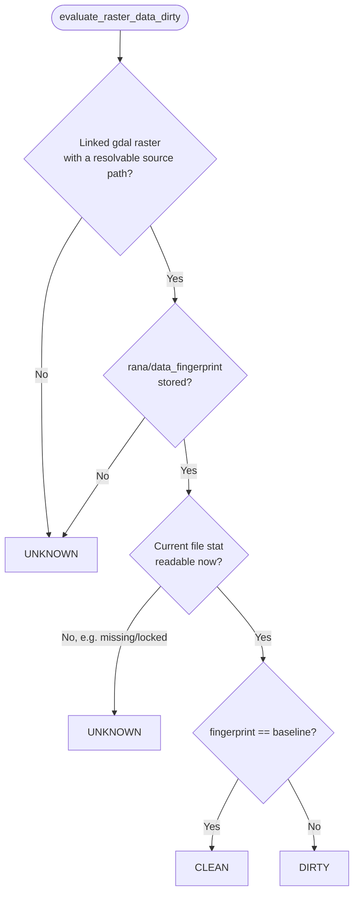
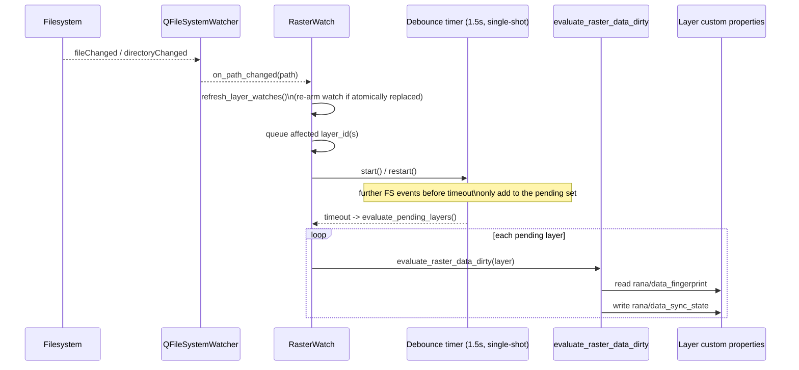
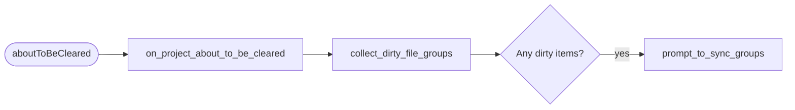
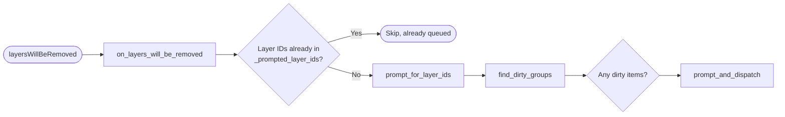
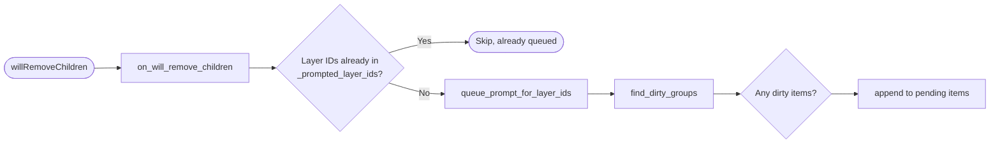

# Dirty-state tracking

This document describes how the plugin tracks unsynced local changes on
Rana-linked layers, and how that state is surfaced and acted on. Layer
opening and Rana-reference metadata are documented in
[`layer_management.md`](layer_management.md).

## Why

A Rana-linked layer's local file or style can diverge from what is stored in
Rana (edits committed in QGIS, a style change, or a raster file replaced on
disk). The plugin needs to know when that happens so it can enable the right
"Save ... to Rana" actions, show a warning badge, and prompt before changes
are lost when a layer, group, or project is closed.

## State model

State is stored as QGIS custom properties on the layer, under the `rana/`
namespace, so it persists with the project without a separate registry:

| Property                   | Meaning                                              |
| --------------------------- | ----------------------------------------------------- |
| `rana/data_sync_state`     | One of `clean`, `dirty`, `unknown` ([`LayerSyncState`](../rana_qgis_plugin/layer_management/layer_sync_state.py)) |
| `rana/style_dirty`         | Boolean: style changed locally since the last sync    |
| `rana/data_fingerprint`    | Raster only: baseline fingerprint of the uploaded file |

`LayerSyncState` is a tri-state, not a boolean:

- **`clean`** — matches the last synced/uploaded state.
- **`dirty`** — known local changes exist.
- **`unknown`** — dirtiness can't currently be determined (e.g. a raster
  whose baseline fingerprint is missing or unreadable).

Consumers do **not** all treat `unknown` the same as `dirty` — see
[Consequences of each state](#consequences-of-each-state) below for exactly
which ones do. `layer_sync_state()` (`layer_sync_state.py`) is the single read
path; it lazily computes and caches the state via `rana/data_sync_state` if
it hasn't been set yet.

Style dirtiness (`has_unsynced_style()`) and data dirtiness are tracked and
cleared independently, since a user can change one without the other.

## How state becomes dirty

Vector and raster data use different detection strategies, because a vector
layer has an in-QGIS edit/commit lifecycle to hook into, while a raster is
just a file on disk that can change outside QGIS entirely.

**Vector data** — `attach_dirty_tracking()` (`layer_dirty_flags.py`) connects
`QgsVectorLayer.afterCommitChanges` to set `rana/data_sync_state` to `dirty`.
This is event-driven: dirtiness is known immediately after a commit.

**Raster data** — there is no commit signal, so dirtiness is inferred by
comparing the uploaded file against a stored baseline:

- `fingerprint_file()` (`file_fingerprint.py`) hashes the file's name, size,
  and nanosecond mtime (not its contents) into a short digest.
- `capture_raster_baseline()` (`raster_dirty_evaluator.py`) stores that
  digest as `rana/data_fingerprint` and marks the layer `clean`, right after
  a layer is opened or a data upload succeeds.
- `evaluate_raster_data_dirty()` recomputes the current fingerprint and
  compares it to the baseline, setting `clean`/`dirty`/`unknown` accordingly.

The fingerprint is a hash of the file name, size, and nanosecond mtime — not
file contents — so this is a cheap stat-based check, not a checksum of the
raster data itself. A restored or copied-back file with identical name, size,
and mtime would read as `clean`, even if the underlying bytes had briefly
differed; sub-mtime-resolution writes are not expected in practice for the
cache-directory files this is scoped to.

This comparison needs to be triggered from somewhere, which is
[`RasterWatch`](../rana_qgis_plugin/layer_management/raster_watch.py)'s job:
it registers a `QFileSystemWatcher` on each linked raster's source file,
debounces bursts of filesystem events (default 1.5 s), and then calls
`evaluate_raster_data_dirty()` for the affected layers. It also re-attaches
the watch when a file is atomically replaced (Qt drops the watch on the old
inode). Layers are tracked from `layersAdded` and untracked on
`layersWillBeRemoved`/`cleared`.

Because filesystem events can be missed or delayed, dirtiness is also
re-evaluated on demand immediately before anything that needs an accurate
answer — the context menu and both `close_sync_prompt.py` classes call
`evaluate_raster_data_dirty()` for the relevant layers right before deciding
what to show.

**Style** — `styleChanged` (connected for both vector and raster layers in
`attach_dirty_tracking()`) sets `rana/style_dirty = True`. There is no
baseline/fingerprint model for style; any change marks it dirty.

## How state is cleared

Clearing only happens after the corresponding sync task reports success
(`Loader.handle_sync_completed()` in `loader.py`), and differs by kind:

- **Style sync** — `rana/style_dirty` is removed.
- **Vector data sync** — `rana/data_sync_state` is set back to `clean`.
- **Raster data sync** — `capture_raster_baseline()` is called again, since a
  re-upload only matches a *new* baseline (the file's mtime/size changed, but
  the content is now what's on the server).

A failed or canceled task leaves the dirty state untouched.

## Consumers

Three things read `layer_sync_state()`/`has_unsynced_style()`, and they
deliberately don't all react the same way:

### Consequences of each state

| Data state | "Save data to Rana" action | Layer-tree badge | Close/removal prompt |
| ---------- | --------------------------- | ----------------- | ---------------------- |
| `clean`    | disabled                    | not shown          | not raised             |
| `dirty`    | enabled                     | shown              | raised                 |
| `unknown`  | enabled                     | **not shown**      | **not raised**         |

(Style dirtiness is a separate boolean and is always treated the same way
everywhere: dirty style enables "Save style to Rana", shows the badge, and
raises the prompt.)

So an `unknown` raster — e.g. its cache file briefly becomes unreadable, or
its baseline fingerprint is missing — gets no passive warning at all: no
badge in the layer tree, and no prompt when the layer, its group, or the
project is closed. The only place it's visible is that "Save data to Rana"
stays enabled in the context menu, so a user who checks can still sync it
manually; nothing surfaces it to a user who doesn't check. This is a
deliberate asymmetry: the badge and close-prompt are reserved for *confirmed*
local changes to avoid false positives, while the manual action stays
available whenever data isn't confirmed clean, as a fallback. If this
trade-off ever needs revisiting (e.g. because `unknown` turns out to be more
common than expected in practice), start from `should_badge()` and
`collect_dirty_file_groups()`, both of which currently check for `DIRTY`
only.

### `layer_tree_menu.py`

For a Rana-linked group, "Save style to Rana" is enabled when any contained
layer has `has_unsynced_style()`; "Save data to Rana" is enabled when any
contained layer's `layer_sync_state()` is not `clean` (so `dirty` or
`unknown`). Both are disabled while the file's sync key is locked (see
[Sync locking](#sync-locking)), regardless of dirty state.

### [`IndicatorManager`](../rana_qgis_plugin/layer_management/indicator_manager.py)

Attaches a warning-icon `QgsLayerTreeViewIndicator` to a layer in the layer
tree view when `should_badge()` is true — unsynced style, **or** data state
exactly `dirty` (not `unknown`) — and recomputes the same badge on ancestor
groups so an unsynced change is visible without expanding the tree. It
tracks `customPropertyChanged` on each project layer to react to dirty-state
changes, and keeps indicators in sync as the tree is built or torn down
(`addedChildren`/`willRemoveChildren`/`removedChildren`).

### [`close_sync_prompt.py`](../rana_qgis_plugin/layer_management/close_sync_prompt.py)

Warns before unsynced changes would be lost, and offers to dispatch the
existing sync actions instead of just closing silently. A file group is
considered for the prompt when it has unsynced style, **or** when a
contained layer's data state is exactly `dirty` (`unknown` is excluded, same
as the badge). The prompt text names each affected file using its Rana
reference (`UploadableLayerItem.rana_ref.file_id` /
`StyleUploadItem.file_ref_str`), not the (possibly renamed) QGIS layer-tree
group label.

Two classes handle two different triggers, built on a shared
`SyncPromptAction` (ask + dispatch-or-discard) so both produce the identical
dialog/outcome:

- **`ProjectCloseSyncPrompt`** — whole-project clear/switch/quit.
- **`LayerRemovalSyncPrompt`** — an individual dirty layer/group removed
  while the project stays open.

For the signals involved and the cascade-batching/dedup mechanics, see
[`signals.md`](signals.md#closeremoval-sync-prompt). Each class's decision
flow:

**`ProjectCloseSyncPrompt`** — triggered once, synchronously, when the whole
project is cleared (closing, switching projects, or quitting QGIS all clear
the project this way). The entire layer tree is still intact at this point,
so it scans everything in one pass and prompts immediately — no timer, no
accumulation:

**`LayerRemovalSyncPrompt`** — triggered when a single layer or group is
removed while the project stays open (e.g. deleting it from the Layers
panel). It's constructed with a reference to a `ProjectCloseSyncPrompt`
instance and reads its `is_clearing` flag as a guard, so it stays out of the
way when a whole-project clear (above) is already handling the same removal.

Unlike the project-clear route, this one has two separate entry points that
can both fire for the *same* removal, and they're handled differently:

- `layersWillBeRemoved` (the project's layer registry reporting a layer is
  about to be deregistered) is handled immediately — the affected layers are
  already fully known from the signal's argument, so there's nothing to wait
  for:

- `willRemoveChildren` (the layer *tree* reporting nodes about to be
  detached) is handled differently, because removing one group can fire this
  signal several times in a row — once per nested child group — as QGIS
  tears the tree down bottom-up. Each firing only captures its own dirty
  items and appends them to a pending list; nothing is prompted yet:

  A zero-delay, single-shot `QTimer` is (re)started every time this
  appending happens. Because the timer's interval is 0 ms, it never fires
  mid-cascade — Qt only runs queued zero-delay timeouts once the current
  batch of synchronous signal emissions has fully unwound, i.e. after QGIS
  has finished removing every sibling in this cascade. When it does fire, it
  calls `prompt_and_dispatch` exactly once with everything accumulated so
  far, so one group removal (which can span several `willRemoveChildren`
  calls) still produces a single prompt instead of one per child group. If
  another removal starts before the timer fires, it's restarted rather than
  duplicated, so it only ever fires once per settled batch.

## Sync locking

[`LayerLockRegistry`](../rana_qgis_plugin/layer_management/sync_lock.py) is a
shared registry of `(project_id, descriptor_id or file_id)` keys. It isn't
dirty-state and doesn't read it — it's an orthogonal gate that disables the
save actions and causes a new sync to be refused while a file's key is
already locked, regardless of whether that file is `dirty` or `unknown`. It
is consulted by the context menu (to disable actions on a file already
syncing) and by `Loader` (to refuse starting a second sync task for the same
file), and released when that task completes or is canceled.

