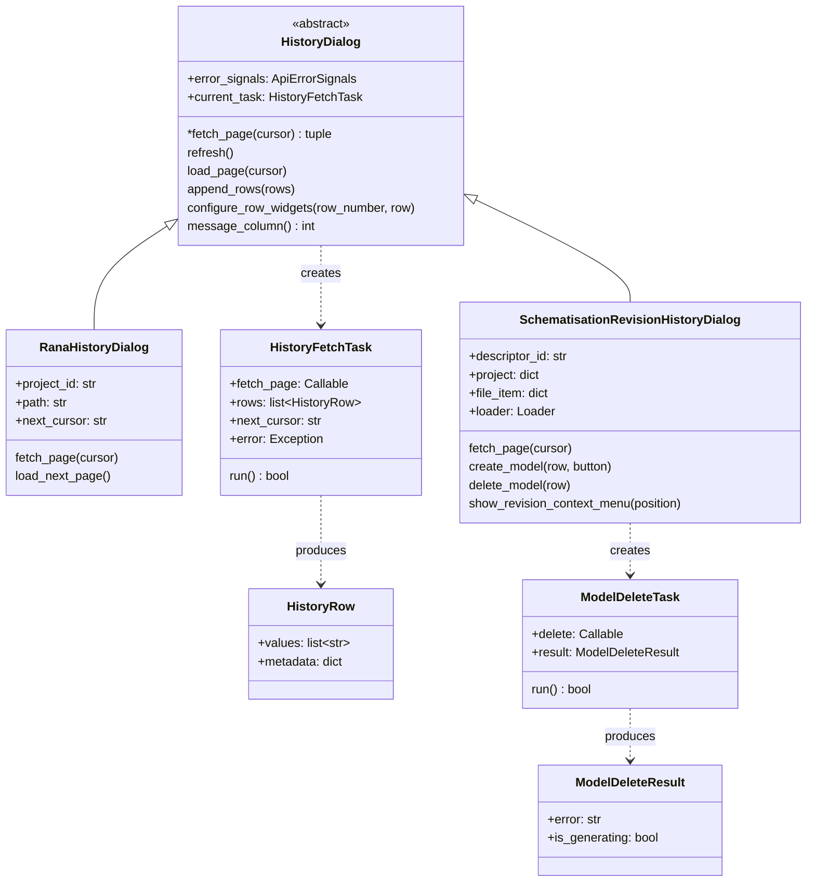
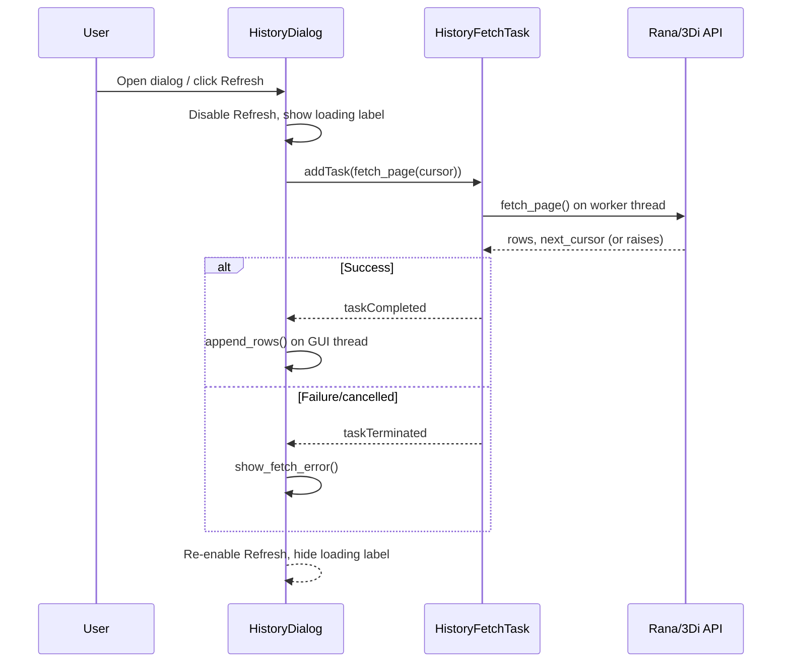

# File and Revision History

## Overview

The **Version history** context-menu action shows read-only history for Rana
files, folders, and the `Files` root, and HCC revision history for
schematisation files. Both views share one asynchronous dialog base:

- `HistoryDialog` owns the table, Refresh control, loading/error labels, and the fetch lifecycle. It has no Rana or HCC API knowledge.
- `RanaHistoryDialog` implements generic Rana file/folder/project history.
- `SchematisationRevisionHistoryDialog` implements HCC revision history and handles availability of the `Simulation` and `Rana Model` action buttons.

Fetching of Rana history runs in a `QgsTask` so long histories do not block the QGIS GUI thread and the history is paginated lazily as the user scrolls. Revision history is fetched completely in one request because button enablement
depends on the full revision list.

## Class structure

The base class owns the asynchronous task lifecycle, but not pagination state or scrollbar behavior. `RanaHistoryDialog` adds cursor state and lazy page loading; `SchematisationRevisionHistoryDialog` uses the base one-shot task lifecycle to fetch its complete revision list.

## Fetch lifecycle

## Lazy pagination (generic history)

`RanaHistoryDialog.fetch_page()` requests one cursor page at a time. `RanaHistoryDialog` triggers the next page automatically when the user scrolls the table to the bottom (`load_next_page()`, connected to both `valueChanged` and `rangeChanged` on the vertical scrollbar, since appending  rows can change the scrollbar range without changing its value).

## Schematisation revision history

`SchematisationRevisionHistoryDialog.fetch_page()` receives only the initial `None` cursor from the base lifecycle and always fetches the complete revision list via `ThreediCalls.fetch_schematisation_revisions()`. This is required because the
`Rana Model` button enablement depends on the exact count of revisions that already have a model, compared against `threedimodel_limit`.

| Column | Label | Enabled when | Tooltip when disabled |
|---|---|---|---|
| `Simulation` | `New` | revision has a model | "A Rana model must be created before a simulation can be started." |
| `Rana Model` | `Delete` | revision has a model | — |
| `Rana Model` | `Create` | no model, no generation in progress, and model count < `threedimodel_limit` | "The maximum number of Rana models has been reached. Please delete one of the existing models before creating a new one." |

When a model is being generated, both Create and Delete are disabled with "The Rana model for this revision is being generated. Click Refresh to update." as tooltip

### Create / Delete behavior

- **Create** first checks `ThreediCalls.has_generating_model_for_revision()`. If generation is detected, or the check fails, creation is blocked and the user is shown an error. Otherwise it calls `Loader.start_model_tracker_process()`. On success it marks the row as generating, disables the clicked button, and calls `Loader.point_user_to_processes()`, which opens the Processes panel (see [processes_panel.md](./processes_panel.md)) and highlights the returned job ID. If the response contains no job ID, the button remains disabled but the user is not pointed to the Processes panel.
- **Delete** asks for confirmation, disables the button, and starts a `ModelDeleteTask` (tracked via `Loader.track_task()`) so the GUI thread is not blocked. On the worker thread, `delete_model_work()` runs the same `has_generating_model_for_revision()` check and then `Loader.delete_schematisation_revision_3di_model()`. The task is deliberately not cancelable (empty flags), so QGIS waits for it on shutdown instead of leaving a half-finished delete. The task never raises; it returns a `ModelDeleteResult(error, is_generating)`, and any unexpected exception becomes `error`. On the GUI thread, `delete_task_complete()` then handles the outcome:
  - generating: the row is marked generating, the button is re-enabled, and an error is shown;
  - error: the button is re-enabled and the error is shown, with the table unchanged;
  - success: `update_action_columns_after_delete_success()` updates the existing table in place without a new API request.

  Results are ignored if the dialog has been closed in the meantime.

The dialog does not poll the server. Use **Refresh** to update generating state. A click-time server check also protects against stale dialog state when a model starts generating after the last refresh. Job progress is visible in the Processes panel (see [processes_panel.md](./processes_panel.md)).

### Revision row context menu

Right-clicking a revision row (`show_revision_context_menu`) offers:

- **Open** — passes the selected revision's ID through
  `OpenSchematisationRequest(project, file_item, revision_id)` to
  `Loader.open_items()`, so a non-latest revision can be opened explicitly.
  The default double-click/`Open in QGIS` action is unaffected and still
  opens the latest revision.
- **Open in web viewer** — substitutes the selected revision's ID into the
  schematisation's existing `management_url` and opens it with
  `QDesktopServices.openUrl()`.
