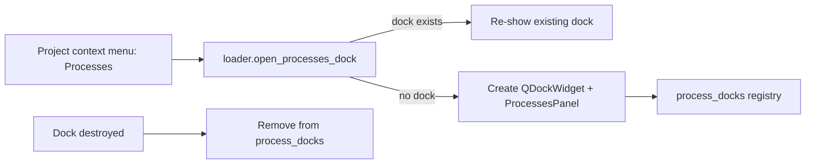
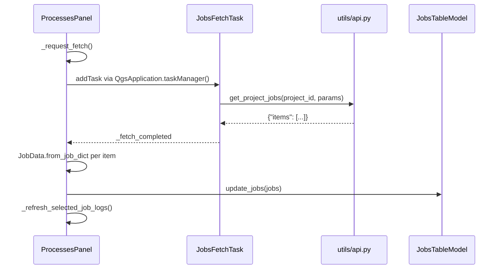
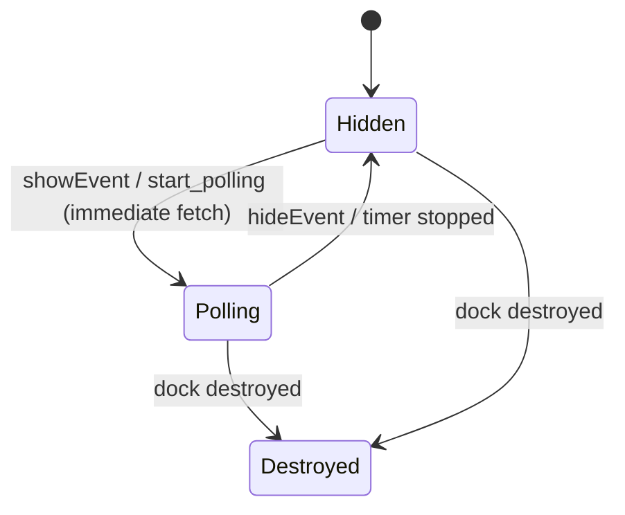
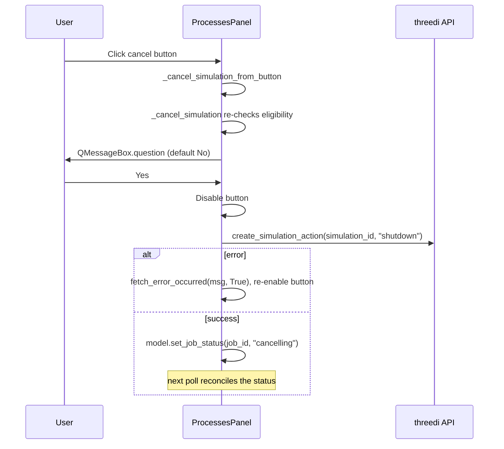

# Processes panel

The Processes panel shows the Rana jobs of a project in a floating dock. It lists jobs, filters them on the server, shows per-job logs, and lets the user cancel running simulations. The panel polls the Rana jobs API every 10 seconds while it is visible.

Main code:

- [widgets/processes_panel.py](../rana_qgis_plugin/widgets/processes_panel.py): `ProcessesPanel`, `JobsTableModel`
- [widgets/jobs_models.py](../rana_qgis_plugin/widgets/jobs_models.py): `JobData`, `JobParseError`, `job_can_be_cancelled`
- [workers/rana_jobs.py](../rana_qgis_plugin/workers/rana_jobs.py): `JobsFetchTask`
- [widgets/filter_bar.py](../rana_qgis_plugin/widgets/filter_bar.py): `FilterBar`
- [loader.py](../rana_qgis_plugin/loader.py): dock management and deep linking

## Opening the panel

## Layout

Below the filter bar, a vertical `QSplitter` holds the jobs table and a log box. The log box is a `QgsCollapsibleGroupBox` titled "Show log" while collapsed and "Hide log" while expanded; it starts collapsed. Expanding it restores the last height the user dragged the splitter to (`_log_height`), or a quarter of the panel on first use, and refreshes the selected job's logs. The user-chosen height is only remembered while the log is expanded.

User cells in the table show avatars through `Loader.get_avatar_for_user`, which uses the shared avatar cache; `ProcessesPanel` updates the cells when `Loader.avatar_updated` fires. See [signals.md](signals.md#avatar-loading).

## Data model

`JobData` is a dataclass built with `from_job_dict`. If an API item cannot be parsed, `from_job_dict` raises `JobParseError`.

`job_can_be_cancelled` returns true when the job status is `running` and its `process_id` matches the simulation tracker process.

### Reconciliation

`JobsTableModel.update_jobs` reconciles the table by job ID rather than rebuilding it:

1. Rows for jobs absent from the API response are removed.
2. New jobs are inserted.
3. Existing rows are moved to the API order with `beginMoveRows`.
4. `dataChanged` is emitted only when a job's `JobData` differs from the stored one.

Because rows are updated in place, selection and scroll position survive a refresh.

## Fetching jobs

- `JobsFetchTask(QgsTask)` has flags `CanCancel | CancelWithoutPrompt | Silent`. Its `run()` calls `get_project_jobs`.
- `get_project_jobs(project_id, params)` merges `{"project_id", "limit": 100}` with the filter parameters and sends a GET to `{api_url()}/tenants/{tenant}/jobs`. The result is read from the `items` key.
- Each item is parsed in `_fetch_completed`. A `JobParseError` is reported with `fetch_error_occurred(msg, False)`, and the remaining items are still processed.

### Request coalescing

- `_request_fetch` allows at most one `JobsFetchTask` at a time.
- A request made while a fetch is running sets `_fetch_requested`, so exactly one follow-up fetch is queued.
- `_continue_requested_fetch` drains that queued request once the running task finishes.
- If the filters changed while a fetch was in flight, its result is discarded and a new fetch is queued.
- Tasks that are no longer `self._current_task` are dropped as stale.

### Triggers

A fetch is requested from these places:

| Trigger | Entry point |
|---|---|
| Poll timer (10 s) | `_poll_jobs` |
| Filter change | `filters_changed` → `_on_filters_changed` |
| Deep link | `highlight_jobs` |
| Selection change (logs refresh only, no job fetch) | selection model signal → `_on_selection_changed` |
| Completed fetch | `_fetch_completed` |

## Polling lifecycle

## Cancelling a simulation

- Cancelling uses the threedi API (`ThreediCalls(get_threedi_api())`), not the Rana jobs API.
- The request is synchronous.
- The status change is local until the next poll shows the server state.

## Deep linking from other flows

`point_user_to_processes(project, job_ids, error_signals, parent)` opens the panel and highlights jobs:

1. If no dock exists for the project, the user is asked first via `communication.ask`.
2. The panel is shown and `panel.highlight_jobs` is called.

Callers:

- [loader.py](../rana_qgis_plugin/loader.py): after simulation tracker jobs start.
- [widgets/version_history_dialog.py](../rana_qgis_plugin/widgets/version_history_dialog.py).
