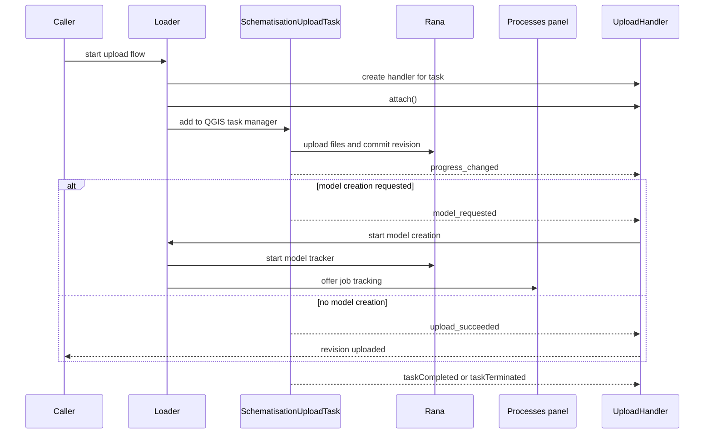
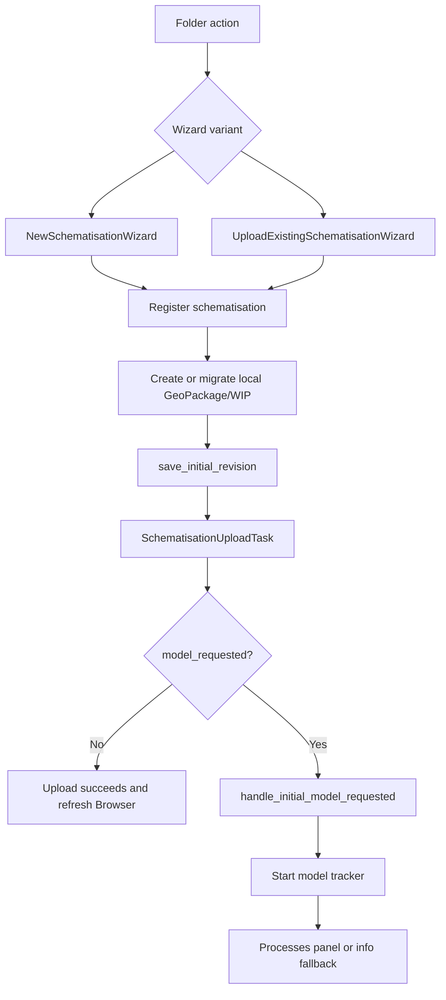
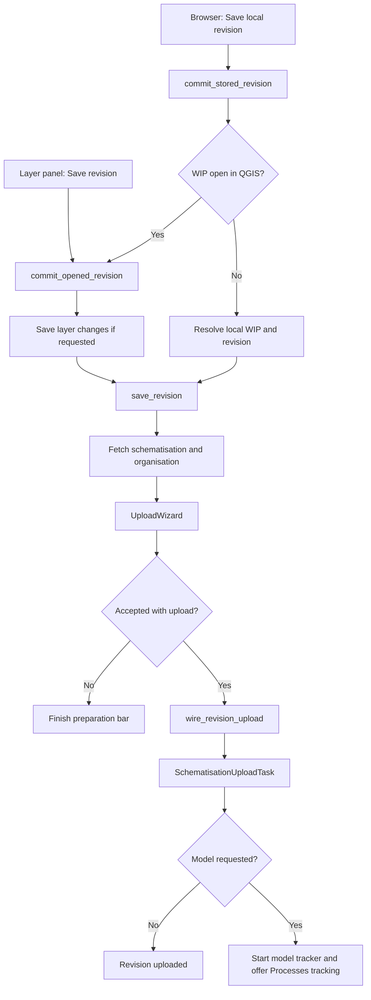

# Schematisation lifecycle

This document describes the two related workflows that are orchestrated by
`Loader`: creating a new schematisation and uploading a later revision. They
share the background upload task and model-creation hand-off, but have
different preparation steps.

## Shared components

`SchematisationUploadTask` (`simulation/workers.py`) performs the asynchronous
HCC upload and commit. The task emits progress, commit, success, model-request,
and termination signals. It also records its outcome as attributes:
`committed_revision` is set once the revision is committed (`None` before that),
and `error_message` holds the failure text. An upload handler in
`workers/upload_handlers.py` connects the signals and uses these attributes to
pick the terminal message. `Loader` owns the QGIS message-bar and
Processes-panel interactions that the handlers call.

The shared model-creation path is:

```text
start_model_tracker_process()
    -> point_user_to_model_creation()
        -> point_user_to_processes()   (when job id and project are available)
        -> info message                 (otherwise)
```

Progress helpers live in `communication.py`. They update one existing message-
bar item rather than creating an item for every task signal.

The shared asynchronous part can be viewed as follows:



## Upload handlers

`workers/upload_handlers.py` holds the code that reacts to the task's signals.
`UploadHandler` is an abstract base class with the wiring that both upload flows
share:

- `connect()` connects `progress_changed`, `model_requested`,
  `upload_succeeded` and `taskTerminated` to the handler's methods.
- `on_upload_progress()` forwards progress to `show_progress()`. It ignores
  ticks after the hand-off, because the progress item is gone by then.
- `on_model_requested()` sets `handed_off` and calls `start_model_creation()`.

Each subclass implements four hooks: `show_progress`, `start_model_creation`,
`on_upload_succeeded` and `on_task_terminated`. The handler keeps the state its
callbacks share, so the code doesn't need closures with `nonlocal`.

`attach()` stores the handler on the task (`task._upload_handler`) before
connecting. This reference is required: PyQt stops calling slots whose receiver
has been garbage-collected, and a handler that nothing references would stop
reacting silently. The handler therefore lives as long as the task.

The two subclasses:

- **`InitialRevisionUploadHandler`** (new schematisation). Progress goes to step 1
  of the wizard's progress item. Model creation calls
  `Loader.handle_initial_model_requested`. On success it calls the Browser
  refresh callback. On termination it calls `handle_initial_revision_upload_failure`.
- **`RevisionUploadHandler`** (later revision). Progress updates a single item,
  with the label "Waiting for model checker" for the `MAKE MODEL` step. Model
  creation finishes the progress item and calls `start_model_tracker_process`,
  then `point_user_to_model_creation`. On success it reports the revision number,
  unless the hand-off already happened. On termination it reports cancellation,
  "uploaded but no model was created" (when `committed_revision` is set), or a
  plain failure, using `error_message`. It also receives an `on_finished`
  callback that releases the upload lock on `taskCompleted` and `taskTerminated`.

Both handlers are created by `Loader`: `build_initial_revision_task` for the
initial upload, and `wire_revision_upload` for later revisions.

## Creating a new schematisation

The entry points are the **From scratch** and **Upload existing** actions in a
Rana Browser folder (`data_items/folder_item.py`). Both use a subclass of
`SchematisationWizardBase`:

```text
folder action
  -> NewSchematisationWizard or UploadExistingSchematisationWizard
  -> wizard registers the schematisation in Rana
  -> wizard creates or migrates the local GeoPackage/WIP
  -> Loader.save_initial_revision()
  -> SchematisationUploadTask
  -> Loader.handle_initial_model_requested()
  -> start_model_tracker_process()
  -> Processes panel, or an informational fallback
```



The wizard owns local preparation and uses one progress item for its three
phases: preparation, initial revision upload, and model hand-off. Details of
the wizard pages and progress mapping are in
[Schematisation wizards](schematisation_wizard.md).

`save_initial_revision()` builds the upload specification, creates the task,
and connects its signals. It is intentionally separate from `save_revision()`:
an initial revision belongs to a newly registered schematisation and does not
use the later-revision upload lock.

## Uploading a later revision

There are two entry points, but both converge on `save_revision()`:

```text
Layer panel: Save revision
  -> commit_opened_revision()
     -> save layer changes, if requested
     -> save_revision()

Browser: Save local revision
  -> commit_stored_revision()
     -> resolve local WIP and revision
     -> commit_opened_revision()   (if the WIP is open)
        or save_revision()
```

The shared core is:

```text
save_revision()
  -> fetch schematisation and organisation
  -> show UploadWizard
  -> on acceptance, create SchematisationUploadTask
  -> wire_revision_upload()
  -> add task to the QGIS task manager
```

`wire_revision_upload()` creates a `RevisionUploadHandler` (in `workers/upload_handlers.py`) and attaches it to the task. The handler updates one progress item in place. On completion it
reports the uploaded revision. On cancellation or failure it removes the item
and reports the outcome. If the revision was committed but model creation
fails, the message explicitly says that the revision was uploaded but no model
was created. If model creation starts, the same model-creation path described
above is used.

The layer group's `rana/revision_number` is **not** rewritten after a later
revision upload. It continues to describe the revision with which the group
was opened; the Browser/local state is refreshed separately.

The two later-revision entry points converge as shown here:



## Important distinction

`doc/file_upload.md` describes the generic file upload pipeline and
`FileUploadTask`. That is separate from schematisation revision uploads, which
use `UploadWizard` and `SchematisationUploadTask`.

## Main code locations

| Responsibility | Location |
|---|---|
| Wizard preparation | `widgets/schematisation_new_wizard.py` |
| New-schematisation orchestration | `loader.py`: `save_initial_revision`, `handle_initial_model_requested` |
| Later-revision entry points | `loader.py`: `commit_opened_revision`, `commit_stored_revision` |
| Shared later-revision core | `loader.py`: `save_revision`, `wire_revision_upload` |
| Upload progress and messages | `workers/upload_handlers.py`: `UploadHandler`, `InitialRevisionUploadHandler`, `RevisionUploadHandler` (see [Upload handlers](#upload-handlers)) |
| Background upload | `simulation/workers.py`: `SchematisationUploadTask` |
| Progress and message-bar helpers | `communication.py` |
| Layer-panel action | `layer_management/layer_tree_menu.py` |
| Browser actions | `data_items/folder_item.py`, `data_items/file_item.py` |
