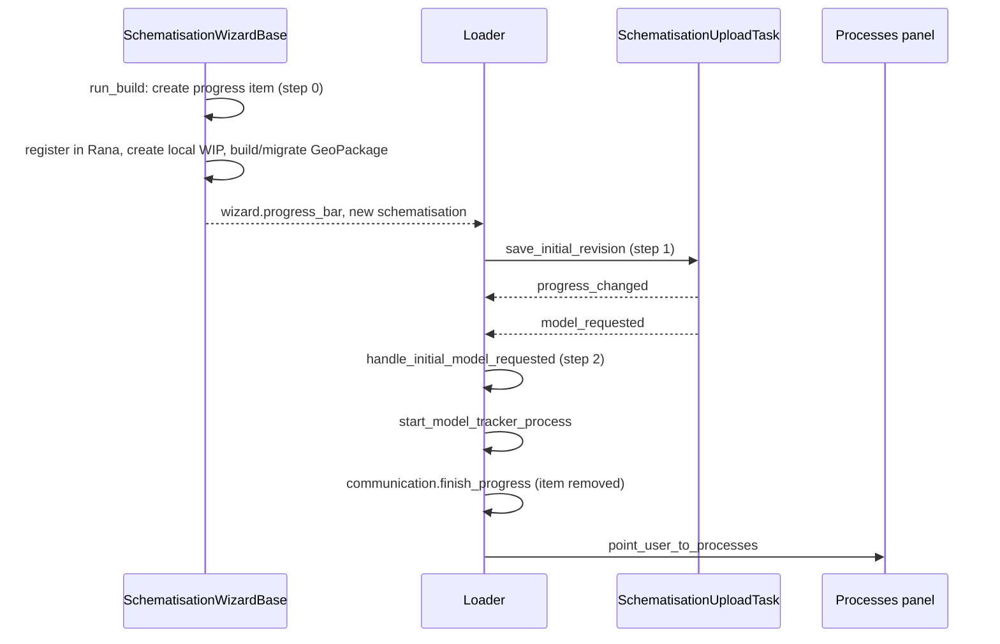
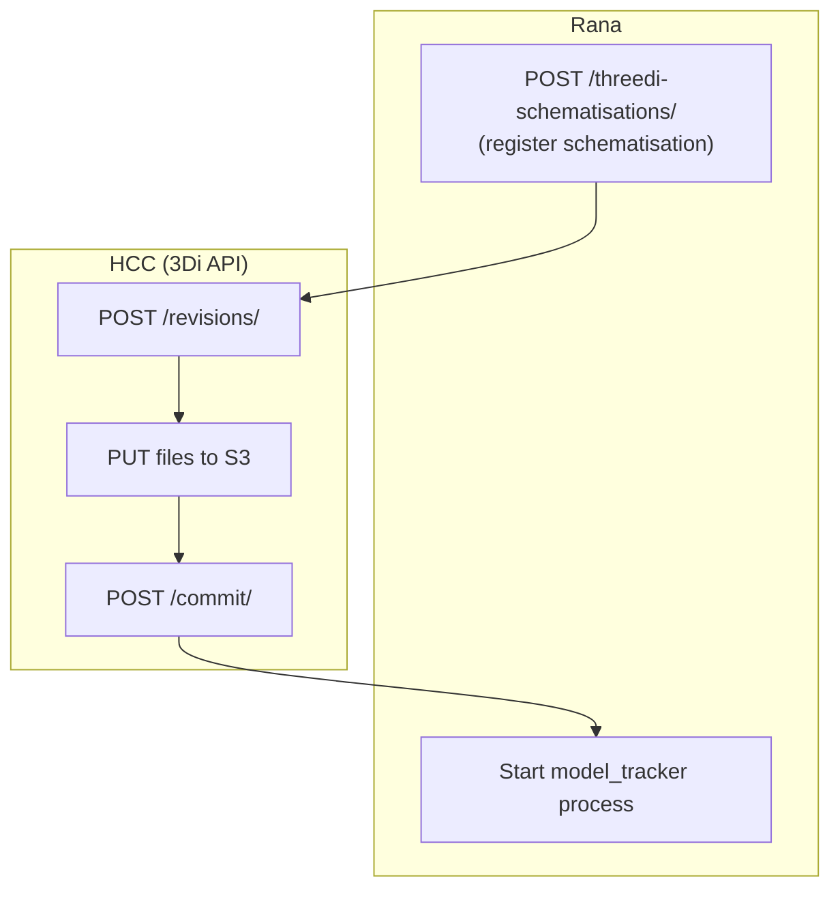

# Schematisation wizards

Creating a schematisation in Rana happens in two phases: a wizard prepares the schematisation locally, then the loader uploads the initial revision and requests the 3Di model. Both phases report through one progress item in the QGIS message bar.

Main code:

- [widgets/schematisation_new_wizard.py](../rana_qgis_plugin/widgets/schematisation_new_wizard.py): `SchematisationWizardBase`, `NewSchematisationWizard`, `UploadExistingSchematisationWizard`
- [loader.py](../rana_qgis_plugin/loader.py): `save_initial_revision`, `build_initial_revision_task`, `handle_initial_model_requested`, `start_model_tracker_process`
- [data_items/folder_item.py](../rana_qgis_plugin/data_items/folder_item.py): starts the wizard and the loader upload

## Entry points

- **New schematisation**: `NewSchematisationWizard`. The user enters a name and description and the schematisation settings and rasters; the wizard creates and populates a GeoPackage.
- **Existing schematisation**: `UploadExistingSchematisationWizard`. The user provides an existing GeoPackage/SQLite file; it is copied into the working directory and migrated.

Both share `SchematisationWizardBase`, whose `run_build` wraps the wizard-specific build (`_build_new_schematisation` / `_build_existing_schematisation`) with progress and error handling.

## Overview

## API calls

In the native datasource, the schematisation is registered in Rana first (`_create_schematisation_base`), which differs from the legacy 1.2.15+ flow where registration came last. Because of this, a failure after registration leaves a registered schematisation behind; `_fail_build` appends its name and id to the error message so the user knows.

## Single progress item

`run_build` creates one message-bar progress item, "Preparing schematisation", and stores it as `wizard.progress_bar`. The loader receives it and keeps using it. The bar covers three equally weighted steps:

| Step | Range | Owner | Detail text examples |
|------|-------|-------|----------------------|
| 0: Preparation | 0-33% | wizard | migration feedback messages |
| 1: Initial upload | 33-66% | loader | "Uploading initial revision", "Uploading revision: <name>" |
| 2: Model hand-off | 66-100% | loader | "Starting model creation" |

`communication.update_step_progress(pb, step, step_pct, detail=None)` sets the overall value to `(step + step_pct / 100) * 100 / 3` and optionally replaces the message text. `QgsMessageBar` shows the text in a `QTextBrowser` of the widget holding the bar, so the helper finds it through the progress bar's parent. If no text widget is found, the detail is logged.

`communication.finish_progress(iface, pb)` removes the message-bar item. The helpers accept `None` and handle a progress bar the user has already dismissed (`sip.isdeleted`): the update is logged instead of raising.

## Schema migration

For both wizards, `schema.upgrade` reports progress through `feedback_callback`, which maps it to step 0. `upgrade()` adds a handler to the `alembic.runtime.migration` logger and never removes it. The wizard records the handlers before the call and removes any new ones afterwards (in a `finally`), so no stale callback is left pointing at a progress bar that no longer exists.

## Initial revision upload

`Loader.save_initial_revision` builds a `SchematisationUploadTask` (`build_initial_revision_task`) and connects its signals:

- `progress_changed`: updates step 1. A `handed_off` flag ignores queued ticks that arrive after the hand-off, when the progress item is already gone.
- `model_requested`: sets `handed_off` and calls `handle_initial_model_requested`.
- `upload_succeeded`: calls the refresh callback of the invoking Browser item.
- `upload_failed`: `handle_initial_revision_upload_failure` removes the progress item and shows either a cancellation warning or the task's error.

If the task cannot be built, `save_initial_revision` removes the progress item and shows a persistent error that the schematisation was created but its initial revision was not uploaded.

## Model hand-off

`handle_initial_model_requested` runs step 2: it starts the model tracker via `start_model_tracker_process`, sets the bar to 100% on success, and always removes the progress item. If a job id is returned, the user is sent to the Processes panel with `point_user_to_processes`, using a custom question "Track model creation for <name> in the Processes window?". See [processes_panel.md](processes_panel.md#deep-linking-from-other-flows).

## Name validation

`SchematisationWizardBase.validateCurrentPage` rejects a name that already exists in the working directory before leaving the name page, via `check_name_available`. The conflict is shown as a warning dialog and the user stays on the page.

## Error handling

- `ApiException` / `RanaPostError` and unexpected exceptions in a build are caught by `run_build`, which closes the progress item, resets the outputs and shows an error message bar.
- A dismissed progress item never raises; updates are logged.
