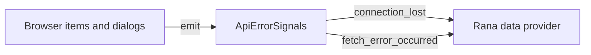
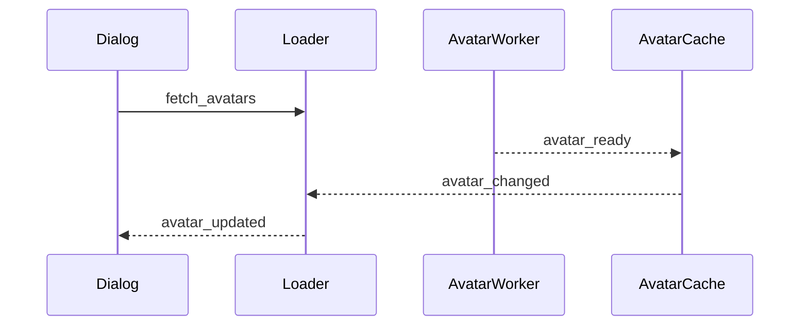
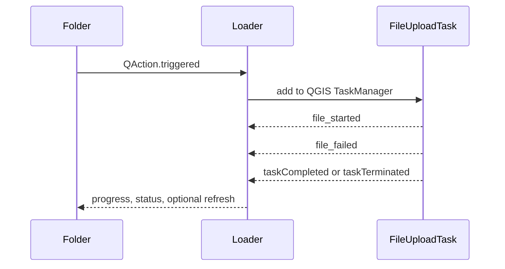
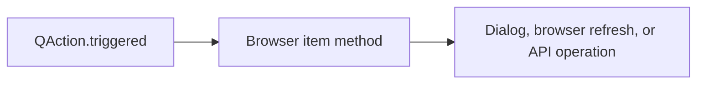
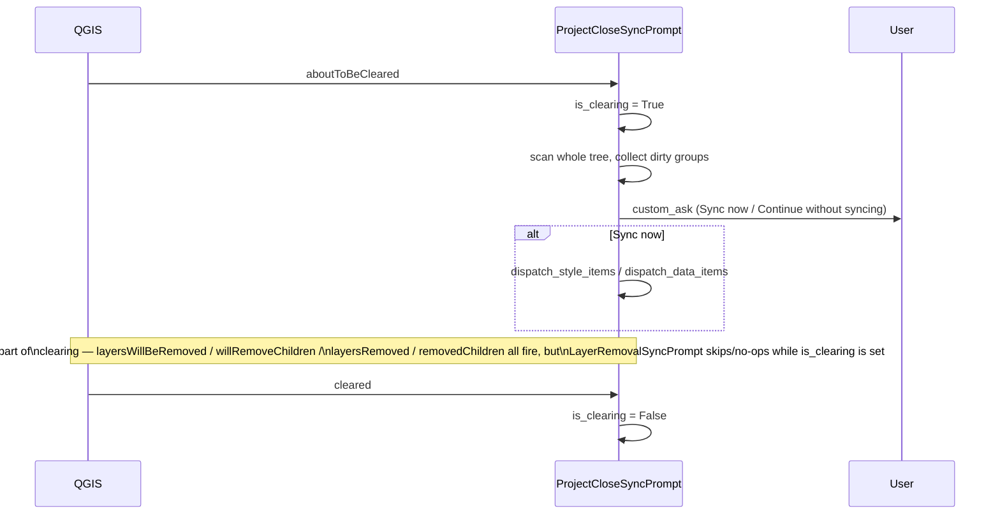
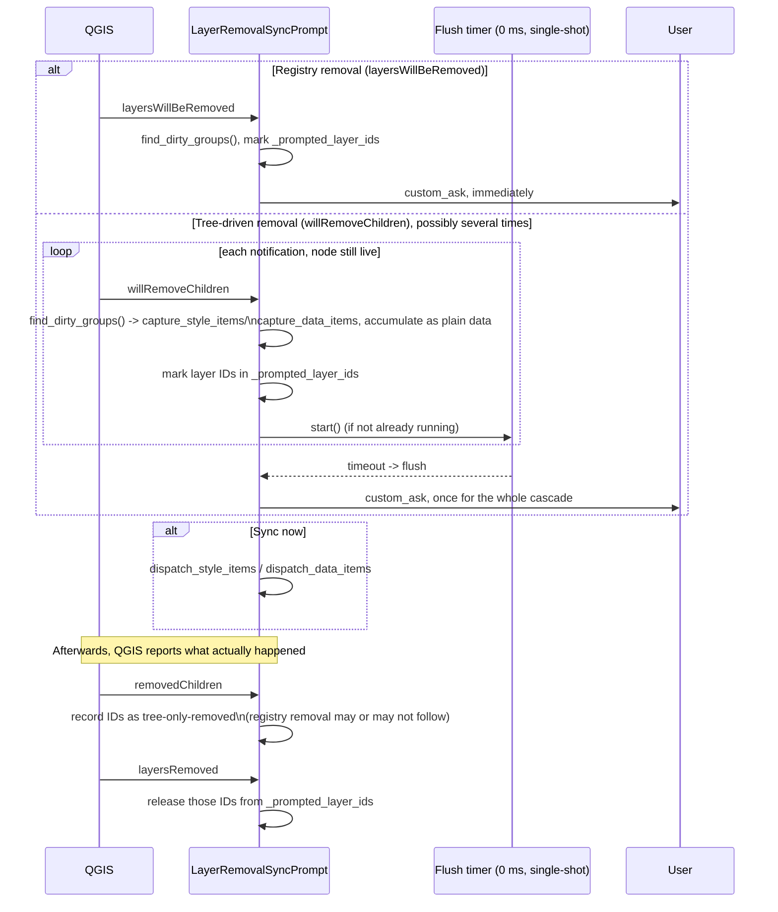

# Signals through the plugin

The plugin uses Qt signals to connect background work, browser items, dialogs,
and shared UI feedback. There is no single signal bus: most signals are
connected near the components that use them. `ApiErrorSignals` and `Loader`
are the main shared connection points.

## Error signals

`ApiErrorSignals` is passed to data items and dialogs that access the API.

- `connection_lost` indicates that the connection could not be used.
- `fetch_error_occurred` carries the error text and a severity indicator.

The provider listens for these signals and turns them into the appropriate
browser or UI response. Components may also connect directly when they need a
local response.

## Avatar loading

Avatar loading is routed through `Loader` so that widgets do not manage the
worker or cache themselves.

The worker signal updates the cache. The cache signal is converted into the
loader's UI-facing `avatar_updated` signal.

## File uploads

The folder action calls `Loader.upload_files()`. Preparation is synchronous;
the actual upload runs as a QGIS task.

The loader consumes task signals and presents progress or completion through
the communication layer. It does not re-emit the task signals.

## Browser actions

Context-menu actions are regular `QAction` signals. They usually call a
method on the item directly:

Examples include login, logout, refresh, project selection, file information,
and folder upload. Only actions that need shared background orchestration are
routed through `Loader`.

## Layer reference updates

`Loader` emits these signals after a Browser operation succeeds:

- `item_renamed(old_path, new_path, project_id, is_folder)` updates the stored path on
  linked QGIS layers below the renamed file or folder;
- `item_deleted(path, project_id, is_folder)` clears Rana references on affected layers,
  leaving the QGIS layers in the project but disabling Rana sync actions.

Remote changes do not emit these signals. They are checked lazily when a save
operation is started.

## Close/removal sync prompt

[`close_sync_prompt.py`](../rana_qgis_plugin/layer_management/close_sync_prompt.py)
warns about unsynced Rana changes before they'd be lost, and offers to
dispatch the existing sync actions instead. Two classes handle two genuinely
different scenarios — **`ProjectCloseSyncPrompt`** (closing/switching/
quitting the whole project) and **`LayerRemovalSyncPrompt`** (removing an
individual dirty layer or group while the project stays open) — built on a
shared `SyncPromptAction` (ask + dispatch-or-discard) so both show the
identical dialog/outcome. Together they connect 6 signals. (Dirty
qualification itself — which groups even count as "unsynced" — is in
[`dirty_tracking.md`](dirty_tracking.md); this section is only about the
connections.)

### `ProjectCloseSyncPrompt` — project clear

- `aboutToBeCleared` scans the whole layer tree synchronously and, if any
  group qualifies, shows **one** prompt immediately — the tree is still
  fully intact at this point, so no snapshotting/batching is needed the way
  it is for individual removal (below). `ProjectCloseSyncPrompt` has no
  dedup/batching state of its own.
- Closing/switching the project, and quitting QGIS, all route through this
  same signal (quitting clears the project as part of its own shutdown) —
  see `20261014-close-sync-prompt-unified-hook.md` for why there's one hook
  instead of a separate quit-specific one.
- `aboutToBeCleared` is not cancelable, so the dialog only offers "Sync now"
  / "Continue without syncing," never "Cancel".
- **This is where the two classes connect**: clearing a project makes QGIS
  internally remove every layer, which fires the exact same signals
  `LayerRemovalSyncPrompt` listens to (below). `is_clearing` (set here,
  cleared on `cleared`) is a public attribute that `LayerRemovalSyncPrompt`
  is given a reference to and reads as a guard, so that cascade of removals
  never produces a second prompt for layers already covered by the one
  whole-project prompt above. It's the one piece of real coupling between
  the two classes — everything else they need (the actual ask/dispatch
  behavior) comes from the shared, stateless `SyncPromptAction` instead.
- `cleared` (fired once QGIS finishes) resets `is_clearing`.
  `LayerRemovalSyncPrompt` connects its own `cleared` handler separately to
  reset its own dedup set (`_prompted_layer_ids`, described next) — the two
  classes don't share that state, only the `is_clearing` flag.

### `LayerRemovalSyncPrompt` — individual layer/group removal

Two independent entry points can fire for the same removal, and they take
different paths:

- `QgsProject.layersWillBeRemoved` (registry-level) is handled directly and
  **immediately** via `prompt_for_layer_ids` — no batching.
- Layer-tree `willRemoveChildren` (tree-level) is routed through the
  **batched** path below, because tree-driven removal of a group fires it
  multiple times for one logical removal.

Both are skipped while `project_close.is_clearing` is `True` (see above).

- A single group removal tears the tree down bottom-up across **several**
  `willRemoveChildren` notifications (one per sibling file group). Each
  group is only still fully live at the moment of its own notification, so
  `queue_prompt_for_layer_ids` captures that group's upload items as plain
  data (`StyleUploadItem`/`UploadableLayerItem`, snapshotting styles to disk
  since the upload runs after the layers are gone) immediately, accumulating
  them in `_pending_style_items`/`_pending_data_items`. Only the actual
  prompt is deferred, via a zero-delay `QTimer`, so the whole cascade
  resolves to a **single** prompt once it has finished emitting.
- `_prompted_layer_ids` deduplicates across both entry points and across a
  multi-notification cascade, so the same layer is never queued twice for
  one removal.
- `removedChildren`/`layersRemoved` run afterwards purely for bookkeeping:
  they determine whether a tree detach was tree-only (e.g. the layer stays
  registered but is moved/hidden) or a full registry removal, and release
  the corresponding IDs from `_prompted_layer_ids` only once that's known —
  otherwise a layer that's momentarily detached but not actually removed
  would be silently skipped if dirtied and removed again later.
- `disconnect()` stops the flush timer and discards any still-pending style
  snapshots, so nothing fires after the plugin unloads.

## Project-selection dialog

The project-selection dialog combines model, filter, and loader signals:

- `Loader.avatar_updated` updates avatar cells.
- `FilterBar.filters_changed` updates the project list.
- Model `dataChanged` and `modelReset` synchronize checkbox state.
- View and button `clicked`, `accepted`, and `rejected` signals drive user
  interaction.

## Adding a new signal flow

Document new flows as a separate section containing:

1. The triggering signal and component.
2. The receiver or worker it invokes.
3. Signals emitted during processing.
4. The final UI update, refresh, or error path.

Keep this document focused on connections and ownership; implementation
details belong in the source code or action-specific documentation.
