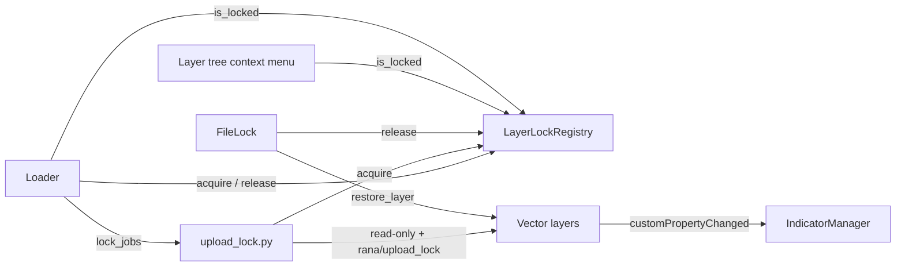
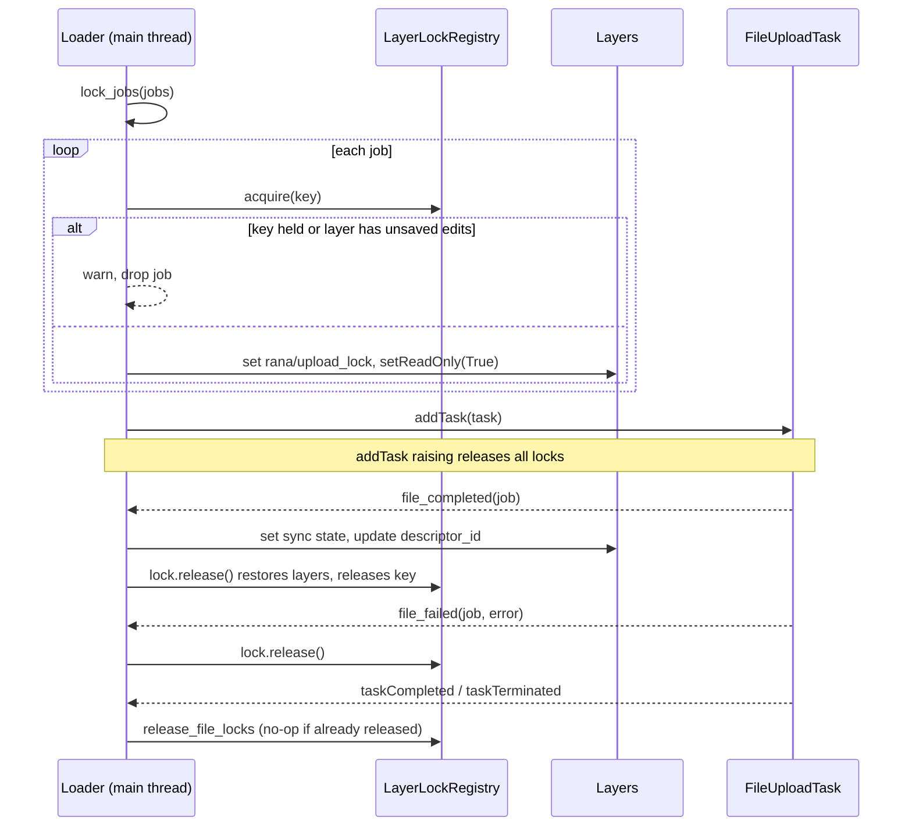

# Sync locking

Sync locking stops two operations from touching the same Rana file at once:
uploads and downloads (opening a file) both take a lock, and anything that
finds the lock held is refused. It is independent of
[dirty tracking](dirty_tracking.md): it never reads dirty state, and a file is
gated whether it is `clean`, `dirty` or `unknown`.

## Components

- [`LayerLockRegistry`](../rana_qgis_plugin/layer_management/sync_lock.py) is
  a set of `(project_id, file_id)` keys, built with `sync_key()`. The stable
  `file_id` is used because the server assigns a new `descriptor_id` on every
  upload. It has `acquire()` (returns `False` if held), `release()` and
  `is_locked()`. It has no signals and does not know who holds a key.
- [`FileLock`](../rana_qgis_plugin/layer_management/upload_lock.py) is the
  handle for one held key plus the layers made read-only for it. Only the
  `FileLock` releases its key, and only once, so a repeated release cannot
  free a key that a newer lock on the same file has taken.
- [`lock_jobs()`](../rana_qgis_plugin/layer_management/upload_lock.py) locks
  all files of an upload on the main thread.

## Who checks the lock

| Check | Effect |
|-------|--------|
| Layer tree context menu (`is_locked`) | Disables the sync actions for a file already syncing. Read when the menu opens, so it is not updated live. |
| `Loader` open/download (`acquire`) | Refuses a second open of a file being uploaded or downloaded. |
| Batch open | Skips files currently being uploaded. |
| `lock_jobs()` (`acquire`) | Drops a file from the upload, with a warning, if its key is held. |
| Style upload (`acquire_sync_keys`) | Refuses with "A sync is already in progress." |

## Data upload

`lock_jobs()` runs on the main thread before the `FileUploadTask` is created.
Per job it:

1. refuses the file with a warning if one of its vector layers is in edit mode
   with unsaved changes;
2. refuses the file with a warning if the key is already held;
3. acquires the key and creates a `FileLock`; and
4. makes every vector layer that reads from the file (all GeoPackage tables)
   read-only, saving the previous read-only state in the `rana/upload_lock`
   layer property.

If locking raises, everything already taken is released before the exception
propagates. Raster layers are not locked: QGIS cannot edit them, so there is
nothing to make read-only. A raster changed on disk during the upload is
detected afterwards by the start-fingerprint comparison described in
[How state is cleared](dirty_tracking.md#how-state-is-cleared).

`file_completed` and `file_failed` release a file as soon as it is done, so
the other files in the same task are unlocked one by one. The `taskCompleted`
and `taskTerminated` handlers are a safety net for files that never reported
(cancellation, crashes in the task). They are harmless for files already
released.

## Style upload

Style uploads use the registry directly, without `FileLock`, because no layers
are made read-only. `Loader.acquire_sync_keys()` takes the keys of all files
at once and releases the ones already taken if any is held. The keys are
released when the target check fails, in `handle_sync_completed` (on
`taskCompleted`), or on `taskTerminated`.

## Download

A download takes the key and holds a `FileLock` without layers. It is
released when `file_downloaded` fires, before the downloaded layer is opened,
so the new layer is not seen as locked. `taskCompleted` and `taskTerminated`
release it as well, in case of cancellation, and the release is also done if
`addTask` raises.

## Layer tree indicators

Locking and unlocking are visible in the layer tree without any lock-specific
signal. Setting or removing `rana/upload_lock` on a layer fires the layer's
`customPropertyChanged` signal. `IndicatorManager` listens to that and calls
`update_layer()`, which shows the upload indicator
(`IndicatorKind.UPLOAD`) on a layer while the property is set and removes it
once `restore_layer()` clears it.

## Stale locks

The lock state lives in the layer property, so it is saved with the project.
If a project is saved during an upload, `restore_stale_upload_locks()` runs on
`readProject`, restores the saved read-only state on every layer and clears
the property. The registry itself is in memory only and starts empty.
